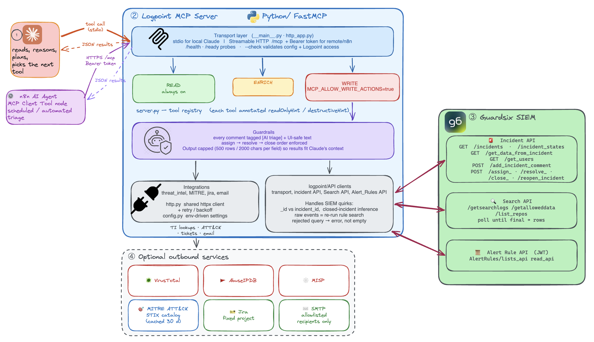

# Logpoint MCP Server


An [MCP](https://modelcontextprotocol.io) server that lets an LLM triage agent (Claude, or an n8n AI Agent) work with a **Logpoint SIEM**. It can read incidents, run searches, enrich indicators with threat intel and, when you allow it, comment on, assign, resolve and close incidents.

It talks to the real Logpoint Incident, Search and Alert Rule APIs. Nothing is mocked.

## Architecture



1. **Clients.** Claude connects over stdio. n8n and other remote agents use streamable HTTP with a bearer token.
2. **MCP server.** Tools are grouped as read, enrich and write. Every call passes through guardrails, then reaches the Logpoint clients or the integrations.
3. **Logpoint SIEM.** The server uses the Incident, Search and Alert Rule APIs.
4. **Optional services.** VirusTotal, AbuseIPDB, MISP, MITRE ATT&CK, Jira, SMTP and Microsoft Teams.

## Tools

| Tool | What it does | Registered when |
|---|---|---|
| `get_incidents` | Incidents in a time window, filtered by status, risk or name, newest first | always |
| `get_incident_details` | Rows the alert rule produced (aggregates for chart rules) | always |
| `get_incident_raw_events` | Raw events behind an incident: re-runs the rule's search part over the incident window | always |
| `get_incident_states` | Live status, assignee and comments, including closed incidents | always |
| `list_users` | Users and groups, for assignment | always |
| `search_logs` / `get_search_results` | Run a Logpoint query and wait for results | always |
| `list_repos` | Searchable repos | always |
| `mitre_attack_lookup` | MITRE ATT&CK Enterprise techniques by id or keywords (official STIX catalog) | always |
| `list_alert_rules` / `get_alert_rule` | Alert rule queries, risk, ATT&CK tags (decoded), metadata, notifications and active state | `LOGPOINT_JWT_*` set |
| `validate_alert_rule` | Check a proposed rule and test-run its query (syntax, matching events, triggers per day). Changes nothing. | `LOGPOINT_JWT_*` set |
| `create_alert_rule`, `update_alert_rule`, `activate_alert_rules`, `deactivate_alert_rules` | Change alert rules (preview first, then apply with a confirm token) | `LOGPOINT_JWT_*` set + `MCP_ALLOW_ALERT_RULE_WRITES=true` |
| `set_alert_rule_email_notification` | Set a rule's email notification: recipients, subject, template (copied from an existing rule or built from columns) | rule writes allowed |
| `delete_alert_rules` | Permanently delete inactive alert rules, after backing them up | rule writes allowed + `MCP_ALLOW_ALERT_RULE_DELETE=true` |
| `lookup_virustotal` / `lookup_abuseipdb` / `lookup_misp` | Indicator reputation | API key set |
| `add_incident_comment`, `assign_incidents`, `resolve_incidents`, `close_incidents`, `reopen_incidents` | Change incidents | `MCP_ALLOW_WRITE_ACTIONS=true` |
| `create_jira_ticket` | Open a Jira issue | writes allowed + `JIRA_*` set |
| `send_email` | Email allowlisted SOC recipients | writes allowed + `SMTP_*` set |
| `announce_teams_triage_run` | Timestamped start-of-run message that @mentions the Teams channel | writes allowed + `TEAMS_WEBHOOK_URL` and `TEAMS_ANNOUNCE_WEBHOOK_URL` set |
| `notify_teams_triage` | Post each triage outcome (verdict, severity, summary, evidence, actions) to a Teams channel | writes allowed + `TEAMS_WEBHOOK_URL` set |
| `notify_teams_alert_rule` | Post an alert rule to the Teams channel: a proposal, or a rule that was created, updated, activated or deactivated | writes allowed + `TEAMS_WEBHOOK_URL` set |

## Quick start

Requires Python 3.10 or later.

```bash
python3 -m venv .venv
.venv/bin/pip install -e ".[dev]"
cp .env.example .env        # then fill in LOGPOINT_URL, LOGPOINT_USERNAME, LOGPOINT_SECRET_KEY
.venv/bin/logpoint-mcp --check
```

`--check` checks the configuration and Logpoint access, then exits. Run it before you connect a client.

## Connecting a client

### Claude Code / Claude Desktop (stdio)

Add the server to `.mcp.json` (Claude Code) or `claude_desktop_config.json` (Claude Desktop):

```json
{
  "mcpServers": {
    "logpoint": {
      "command": "/absolute/path/to/MCPServer-Logpoint/.venv/bin/logpoint-mcp",
      "env": {
        "LOGPOINT_URL": "https://logpoint.example.com",
        "LOGPOINT_USERNAME": "api-user",
        "LOGPOINT_SECRET_KEY": "..."
      }
    }
  }
}
```

The client launches the server from its own working directory, so a `.env` file in the repo is **not** read. Put the settings in `env` instead. Keep files that contain secrets out of version control (`.mcp.json` is in `.gitignore`).

### Remote clients and n8n (streamable HTTP)

```bash
export MCP_AUTH_TOKENS="$(python3 -c 'import secrets; print(secrets.token_urlsafe(32))')"
logpoint-mcp --transport http --host 0.0.0.0 --port 8000
```

- **MCP endpoint:** `http://<host>:8000/mcp`. Clients send `Authorization: Bearer <token>`. In n8n, use the **MCP Client Tool** node with *HTTP Streamable* transport and header auth.
- **Health checks:** `GET /health` (liveness) and `GET /ready` (checks Logpoint access) don't need a token.
- **Authentication is enforced.** The server refuses to listen on a non-loopback address without `MCP_AUTH_TOKENS`, unless you set `MCP_ALLOW_UNAUTHENTICATED=true` because a proxy in front of it handles authentication.
- **Behind a reverse proxy,** set `MCP_ALLOWED_HOSTS` to the public host name (DNS-rebinding protection) and terminate TLS at the proxy.

### Docker

```bash
docker build -t logpoint-mcp .
docker run --env-file .env -e MCP_AUTH_TOKENS=... -p 8000:8000 logpoint-mcp
```

## Configuration

Every setting is an environment variable. See [.env.example](.env.example) for the full list.

| Variable | Default | Notes |
|---|---|---|
| `LOGPOINT_URL`, `LOGPOINT_USERNAME`, `LOGPOINT_SECRET_KEY` | required | API user credentials. They stay on the server and are never tool arguments. |
| `LOGPOINT_VERIFY_SSL` / `LOGPOINT_CA_BUNDLE` | `true` | For a self-signed Logpoint, use the CA bundle instead of turning verification off. |
| `LOGPOINT_SEARCH_TIMEOUT_SECONDS` | `90` | Longest a search tool waits before returning partial results. |
| `LOGPOINT_MAX_ROWS` / `LOGPOINT_MAX_FIELD_CHARS` | `500` / `2000` | Caps tool output so it fits in an LLM context window. |
| `MCP_ALLOW_WRITE_ACTIONS` | `false` | Off: the agent can only read. |
| `MCP_COMMENT_PREFIX` | `[AI triage]` | Tags every comment the agent writes. |
| `MCP_LOG_FORMAT` | `text` | `json` for log shipping. Write actions are logged on the `logpoint_mcp.audit` logger. |
| `MCP_ALLOW_ALERT_RULE_WRITES` / `MCP_ALLOW_ALERT_RULE_DELETE` | `false` / `false` | Alert rule changes, separate from `MCP_ALLOW_WRITE_ACTIONS`. See [Alert rule management](#alert-rule-management). |

## Alert rule management

With `MCP_ALLOW_ALERT_RULE_WRITES=true` (and the `LOGPOINT_JWT_*` settings), the agent can create, update, activate and deactivate alert rules. With `MCP_ALLOW_ALERT_RULE_DELETE=true` as well, it can delete them. The JWT scope gains `alertrules:write` automatically, so the Logpoint user behind `LOGPOINT_JWT_SUBJECT` needs alert-rule rights. Give it nothing more.

An agent that can turn off detections can be talked into turning them off by text in a log line. So every change goes through checks in code that the agent can't skip:

- **Preview, then apply.** Each write tool defaults to `dry_run=true` and returns a preview (payload or field-level diff, query test) plus a `confirm_token`. The change only happens when the same call is repeated with `dry_run=false` and that token, which the agent is told to do only after the analyst approves. The token is an HMAC over the exact change and each rule's current state. It is single-use and expires after `MCP_ALERT_RULE_CONFIRM_TTL_SECONDS` (900). If the arguments differ from the preview, or someone edits the rule in Logpoint in between, the apply is refused.
- **Only the server's own rules.** Rules the server creates carry `managed_by=logpoint-mcp` in their metadata and the name prefix `MCP_ALERT_RULE_NAME_PREFIX` (`AI - `). With `MCP_ALERT_RULE_SCOPE=managed` (the default), rules without the tag can't be changed. Set `all` to allow human-authored rules.
- **Protected rules.** `MCP_ALERT_RULE_PROTECTED` takes rule ids or case-insensitive name globs (`*ransomware*,*edr tamper*`). Those rules can never be changed, deactivated or deleted, whatever the scope.
- **New rules start inactive.** Activation is a separate, separately approved step. Before activating, the preview test-runs each rule's query over the last 24 hours and refuses failing queries, or rules that could fire more than `MCP_ALERT_RULE_MAX_DAILY_TRIGGERS` (50) times a day.
- **Delete is guarded twice.** Only inactive rules can be deleted, so removing a running detection takes two approved changes. Before deleting, each rule's full definition is written to `MCP_ALERT_RULE_BACKUP_DIR` (mode 0600). If the backup fails, nothing is deleted.
- **Rate limit.** At most `MCP_ALERT_RULE_MAX_CHANGES_PER_HOUR` (10) rule changes per hour. Each rule counts.
- **Bounded input.** Rule fields are typed and limited. Incident-view column names and labels can't contain HTML or Jinja, and labels are escaped as well. Queries that match everything (`*`) are rejected. `rule_yaml` accepts the [alert SDK](https://gitlab.com/logpoint/everest/security-research/alert-sdk)'s rule file format. File paths are never accepted.
- **Audit.** Every applied change is logged on `logpoint_mcp.audit` with the rule ids, names, changed fields and reason.

### ATT&CK tags, metadata, columns and email

- **ATT&CK tags.** `create_alert_rule` and `update_alert_rule` take `mitre: [{"technique_id": "T1558.003", "tactic": "Credential Access"}]`. The tactic is only needed when a technique belongs to several. On update, the list replaces the rule's tags. Logpoint stores each tag as `md5("<technique id> <technique name> <tactic name>")`, using names from its own ATT&CK release. The server computes these from a pinned release (`MITRE_LOGPOINT_ATTACK_URL`, default v18.1, which reproduced every tag on the live rules), not from the latest catalog, whose names differ. `get_alert_rule` decodes tags back to techniques.
- **Metadata.** `metadata: {"author", "references", "threat_actor", "associated_malware", "rule_status", "rule_version"}`. It's written to the rule's `taxonomy.metadata` the way existing rules have it: one entry per field, with references comma-separated. On update, only the fields you pass are replaced. Values are plain text, and references must be http(s) URLs.
- **Incident ownership.** `ownership: {"assignee", "visible_to_usergroups" | "visibility_from_rule_id"}` sets who owns a rule's incidents and which user groups see them, on create or update. The assignee must be a Logpoint user (`list_users`); the server stores the exact user name, as Logpoint does. Visibility groups are user groups from `list_users`, given by name or id, or copied from an existing rule (`visibility_from_rule_id`). Logpoint stores them by name, so the server stores the exact group name.
- **Manageable by** (`rbac_config`) is read-only: `get_alert_rule` shows it, but it can't be set. Logpoint fills it in itself, and `update_api` fails with "got multiple values for keyword argument 'rbac_config'" when the request carries it (verified 2026-11-03). Change it in the console.
- **Aggregate columns.** `field_mapping` (and email `columns`) accept the aggregate columns of a chart query, such as `{"count()": "TICKETS", "distinct_count(host)": "HOSTS"}`. They render as `{{row['count()']}}`.
- **Email notifications.** `set_alert_rule_email_notification` uses Logpoint's EmailNotification API. The body template is either copied from an existing rule (`template_from_rule_id`, the SOC's own template; recipients and logo are copied too) or built by the server from `columns`. It never takes free-form Jinja or HTML. Recipients must be recipients of the copied rule or match `MCP_ALERT_RULE_EMAIL_ALLOWED_RECIPIENTS` (addresses or `@domains`). The subject is plain text, where `{rule_name}` becomes the alert name. The same preview, approval, ownership and rate-limit rules apply. Syslog and HTTP notifications are not supported: HTTP would let the agent send alert data to any URL.
- **Validation errors.** When Logpoint rejects a rule (HTTP 422), its field-level `validationErrors` are passed on to the agent.

New rules search `LOGPOINT_ALERT_RULE_REPOS` (`default,_logpoint`) unless the request names repos. Their incidents are owned by `LOGPOINT_ALERT_RULE_ASSIGNEE`, which defaults to the JWT subject. The payload format is ported from the alert SDK. A unit test compares it with the SDK's output when the SDK is importable (`PYTHONPATH=../alert-sdk`, plus `requests`).

Not verified against a live Logpoint yet: the responses of `create_api`, `update_api`, `activate_api`, `deactivate_api`, `delete_api` and `EmailNotification/create_api`, and whether `update_api` accepts the shape `read_api` returns. Try every tool on a lab instance before enabling writes in production. The tag hashing, metadata format and email notification shape were read from live rules (2026-11-02).

### Teams notifications

When `notify_teams_triage` is registered, the server tells the agent to call it once after every triage, after any comment, close or Jira action, so the card lists what actually happened. The card shows the verdict (colour-coded), severity, incident ids, summary, evidence, actions taken and the Jira key.

`notify_teams_alert_rule` posts an alert rule card to the channel behind `TEAMS_ALERT_RULE_WEBHOOK_URL`, or to the triage channel when that isn't set. With `stage=proposed` it shows a rule the agent suggests but didn't create (for example from a threat-intel digest): name, query, risk, condition, log source, ATT&CK ids, why it matters, how the query was tested, expected false positives and the source story. The card says it is a proposal only. With `created`, `updated`, `activated` or `deactivated` it needs a `rule_id`, and the name, query, risk, condition, repos, ATT&CK tags and active state are read from Logpoint, so the card shows the rule as it really is. The tool never changes Logpoint. All text is defanged, like the triage cards.

To set it up, open the channel in Teams and choose **⋯ > Workflows > Post to a channel when a webhook request is received**. Put the URL it gives you in `TEAMS_WEBHOOK_URL`. To send alert rule cards to a separate channel, create the same workflow in that channel and put its URL in `TEAMS_ALERT_RULE_WEBHOOK_URL`. The older Office 365 connector webhooks are retired and aren't supported.

#### Start-of-run announcement with @channel (optional)

With `TEAMS_ANNOUNCE_WEBHOOK_URL` set, the agent calls `announce_teams_triage_run` once before the first card of a run. It posts a message like *@SOC Alerts [AI triage] Triage run started 2026-10-13 09:00 UTC: 5 incidents follow.*

Workflow cards can only mention individual users, not a channel, team or tag. So this message goes through a second workflow that posts with Microsoft Graph **as a user**. Use a dedicated service account, because the message shows up as that account's post.

1. In Power Automate, create a flow with the trigger **When a Teams webhook request is received** (anyone can trigger). The server sends `{"kind", "timestamp", "incident_count", "text"}`.
2. Add **Office 365 Groups > Send an HTTP request**, signed in as the service account (a member of the team):
   - Method `POST`, URI `https://graph.microsoft.com/v1.0/teams/<team-id>/channels/<channel-id>/messages`
   - Body (replace `<channel-name>`, and insert the trigger's `text` as dynamic content):

     ```json
     {
       "body": {"contentType": "html", "content": "<at id=\"0\"><channel-name></at> @{triggerBody()?['text']}"},
       "mentions": [{
         "id": 0,
         "mentionText": "<channel-name>",
         "mentioned": {"conversation": {"id": "<channel-id>", "displayName": "<channel-name>",
                                        "conversationIdentityType": "channel"}}
       }]
     }
     ```
3. Save, then put the flow's webhook URL in `TEAMS_ANNOUNCE_WEBHOOK_URL`.

The team and channel ids are in the channel link (**⋯ > Get link to channel**): `groupId` is the team id, and the `19:…@thread.tacv2` part is the channel id. An @channel mention notifies members who show or follow the channel. To reach everyone in the team, use `"conversationIdentityType": "team"` with the team id and name instead.

## Logpoint behaviour this server handles

These quirks were confirmed against a live Logpoint and are built into the client:

- **Two incident ids.** `get_incidents` returns `id` (24 hex, the object id) and `incident_id` (32 hex). Every API call takes `id`, and the tools reject `incident_id` with a hint.
- **Closed incidents are missing from `/incidents`.** `get_incident_states` combines `/incident_states` and `/incidents`. An id that's in neither is reported as closed with `"inferred": true`.
- **Close order is enforced.** Logpoint only resolves or closes incidents assigned to the API user, and only closes resolved ones. `resolve_incidents` and `close_incidents` assign and resolve first where needed, and report what they did.
- **Incident details are aggregates.** `get_incident_details` returns what the rule produced. `get_incident_raw_events` re-runs the part of the rule query before the first `|` over the incident's time range and repos.
- **Comments are UI-escaped.** The Logpoint UI double-escapes `" ' < > &`, so comments swap them for look-alike characters.
- **Rejected queries are errors.** A query Logpoint rejects (e.g. an unquoted `process`) raises an error, never an empty result.

## Security model

- **Read-only by default.** Write and outbound tools are only registered when `MCP_ALLOW_WRITE_ACTIONS=true` (alert rule changes: `MCP_ALLOW_ALERT_RULE_WRITES=true`), and each is annotated (`readOnlyHint`, `destructiveHint`) so clients can ask for confirmation.
- **Log content is untrusted.** Its text can contain prompt injection, so `send_email` only reaches `SMTP_ALLOWED_RECIPIENTS`, and the Jira project and Teams channel are fixed by configuration. URLs in Teams cards are defanged (`hxxps://`) and Markdown links are broken, so a log line can't plant a clickable link in the SOC channel.
- **Private IPs stay internal.** They're never sent to VirusTotal or AbuseIPDB.
- **Secrets stay out of output.** They're `SecretStr` in memory, and error messages never include request bodies or the Teams webhook URL.
- **Retries are safe.** Reads retry transient failures with backoff. Writes are only retried when the request can't have reached Logpoint (connection failure, HTTP 429), so a comment is never posted twice.

## Development

```bash
.venv/bin/pytest                               # unit tests (fake Logpoint via httpx.MockTransport)
LOGPOINT_LIVE_TESTS=1 .venv/bin/pytest tests/live -v   # read-only checks against a real Logpoint
```

```
logpoint_mcp/
├── __main__.py         CLI: stdio | http | --check
├── config.py           Environment-driven settings, one section per integration
├── server.py           MCP tool definitions and registration rules
├── http_app.py         Streamable HTTP app: bearer auth, /health, /ready
├── services.py         Builds clients from settings and owns their lifecycle
├── http.py             Shared httpx client and retry policy
├── logpoint/           Logpoint API clients (transport, incidents, search, alert rules)
└── integrations/       VirusTotal, AbuseIPDB, MISP, Jira, SMTP, Teams, MITRE ATT&CK
```

To add a tool, put the API call in a client under `logpoint/` or `integrations/` and test it against the fake server. Then register it in `server.py` under the right risk group.
